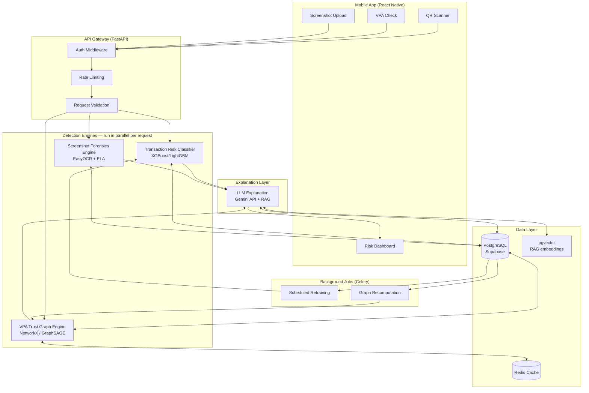
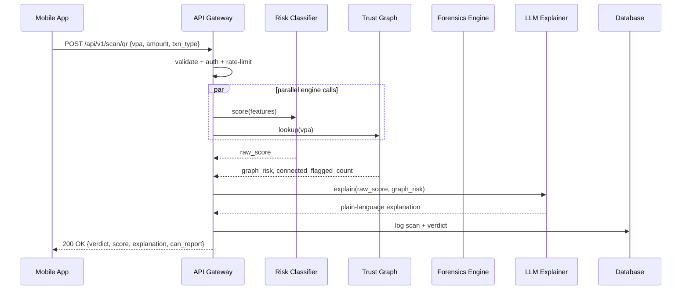
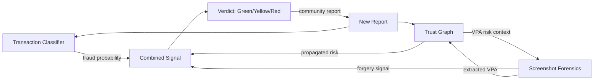
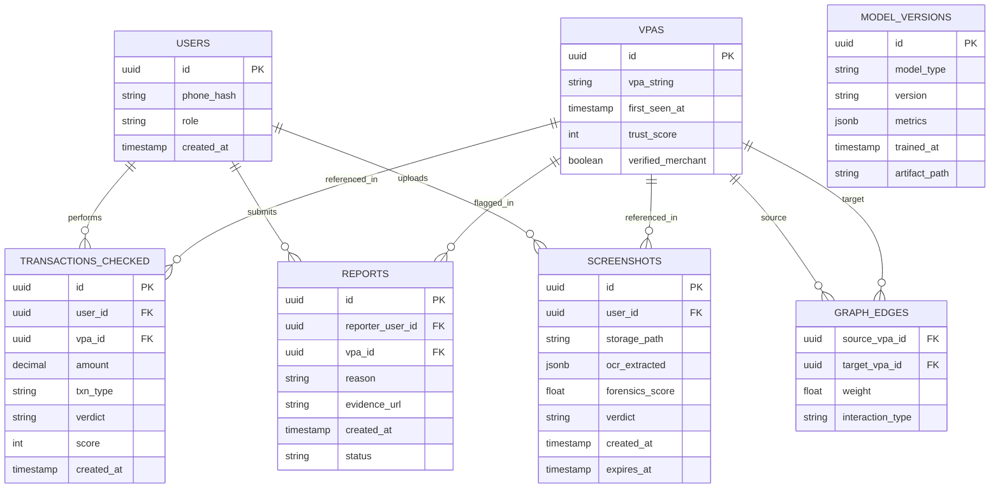

# ScamShield AI — IDP Edition README

**AI-Powered Pre-Payment Risk Detection for UPI QR, VPA, and Payment-Screenshot Fraud**
**Scope: VIT Chennai Innovative Design Project (IDP) — Year-Long Build**

Course context: Innovative Design Project (IDP) — VIT Chennai, CSE Core (Team of 3)
Originated as: PEC Hacks 4.0 (FinTech track) hackathon entry — see the companion document

This is the single source of truth for building the **full, year-long version** of ScamShield AI. It is written to be self-contained — if you, a teammate, your guide, or an AI assistant reads only this file, you should understand the entire IDP-scope project: what it is, why every decision was made, and exactly what is being built. Read Section 0 first.

---

## 0. Read This First — Project Status, Document Scope, and How the Two READMEs Relate

**ScamShield AI now has two separate README documents, on purpose:**

| Document | Scope | Duration | Use it for |
|---|---|---|---|
| `ScamShield_PECHacks_README.md` | Hackathon MVP — 4 unified detection modules | 30 hours | Building/understanding the PEC Hacks 4.0 demo |
| **`ScamShield_IDP_README.md` (this document)** | Full system | 7–8 months, year-long IDP | Building/understanding the complete, evaluated, IDP-grade system |

They describe the **same core idea and the same three threat vectors** (Section 18), but deliberately different engineering depth. The hackathon document scopes down to what is safely buildable by three people in 36 hours — synchronous FastAPI calls, a seeded lookup table, rule-based + baseline scoring, no background job infrastructure. This document describes the full system: trained and evaluated ML models, the trust-graph engine, Celery/Redis background processing, and the research-level GNN/CNN stretch goals. **Do not merge the two scopes back into one build** — the split exists specifically so hackathon week doesn't get derailed trying to build IDP-depth infrastructure under a 36-hour clock (see the Hackathon README's "traps" section for exactly why).

**ScamShield AI (IDP scope) is currently in the design and specification phase.** As of this document, no part of the system described below has been implemented in code. This README is a **build specification**, not a record of finished work — it plays the same role a detailed architecture document plays before implementation starts: it defines exactly what will be built, how, and why, so that any team member (or AI assistant) picking up the project builds the same system instead of improvising a different one.

Because of this, the document distinguishes three tiers of scope throughout, tagged inline wherever it matters:

| Tag | Meaning |
|---|---|
| **(MVP)** | Must exist for the project to be considered working. Section 46 lists these exhaustively. Note: this is the *IDP* MVP, which is already a step beyond the hackathon MVP — see Section 3. |
| **(Advanced)** | Planned for this academic year, adds real technical depth, but the system is still demoable without it if time runs short. Section 47. |
| **(Future)** | Explicitly **not** being built this year. Documented so scope does not silently creep. Section 48. |

Nothing in this document should be read as "already achieved." Model accuracy figures, latency targets, and evaluation metrics quoted below are **design targets**, not measured results — no model has been trained yet. Real-world fraud statistics quoted in Section 4 are external, cited, published figures used to justify *why* the project exists, not claims about ScamShield's own performance.

---

## 1. Project Overview

ScamShield AI is a mobile companion safety application for India's UPI (Unified Payments Interface) ecosystem. It sits **alongside** existing UPI apps (Google Pay, PhonePe, Paytm) — never inside them — and gives a user an instant, explainable risk assessment for a QR code, a VPA (Virtual Payment Address), or a payment-proof screenshot, before money moves or before a claim of payment is trusted.

The system is built around three fraud patterns that concentrate at the point *before* a transaction reaches a bank's own fraud engine:

```text
1. QR Tampering & Swapping        — a merchant's QR is physically or digitally altered
2. Collect-Request Disguise       — a "receive money" prompt that is actually a payment
3. Fake Payment Screenshots       — doctored "payment successful" proof used against sellers
```

ScamShield AI does not process real UPI transactions, does not touch PINs/OTPs/credentials, and does not claim to intercept or block payments inside any bank or UPI app. It is a **pre-payment advisory layer** — see Section 7 for exactly what this means and why the boundary is deliberate, not a limitation to hide.

---

## 2. One-Sentence Project Definition

> A mobile risk-assessment layer where a user submits a QR code, a VPA, or a payment screenshot before trusting it, and receives a Green/Yellow/Red verdict — generated by a trained fraud classifier, a community-built VPA trust graph, and (for screenshots) an image-forensics pipeline — explained in plain language by an LLM and backed by a crowdsourced reporting system that improves the model over time.

---

## 3. Origin & Context

ScamShield AI began as a hackathon concept for **PEC Hacks 4.0** (FinTech track). The hackathon-scale version, fully specified in `ScamShield_PECHacks_README.md`, is scoped for a ~36-hour build: rule-based scoring (with a baseline classifier only if time genuinely allows), a seeded lookup database, synchronous FastAPI endpoints with no background-job infrastructure, and a three-screen app. **This document supersedes that scope for anything about the IDP implementation** — the hackathon blueprint's core problem framing and rule-based scoring logic are preserved and reused here (see Sections 18 and 27), but the technical depth, dataset strategy, background-job architecture, and timeline described in the rest of this document are for the full **year-long IDP build**, done properly rather than at hackathon speed.

If a professor or judge asks *"is this the same project as the hackathon pitch?"* — yes, same core idea and same three threat vectors, same underlying architecture family, but the IDP version replaces every hackathon-speed shortcut (flat seeded lookup, no trained model, no graph engine, no async job queue) with a trained, evaluated, and architecturally deeper system, described fully below. The two documents are meant to be read together, not interchangeably: build the hackathon version from the hackathon README during hackathon week, and build everything beyond that from this document across the rest of the year.

**A deliberate engineering principle carried over from the hackathon build, and kept for the IDP build too:** infrastructure complexity (Celery, Redis, `pgvector`) is introduced only when a phase actually needs it (Section 45), not provisioned upfront "because the architecture diagram has it." Section 31 and the roadmap in Section 45 are written to reflect this — the backend starts as direct, synchronous FastAPI endpoints in Phase 3 and gains background-job infrastructure only from Phase 6 onward, once the trust-graph recomputation workload actually requires it.

---

## 4. Problem Statement — Why This Exists

UPI fraud concentrates on three exploit points that existing bank-level defenses do not fully cover, because they happen **before** the transaction reaches the bank's own fraud engine. First-time digital users, elderly users, and small merchants — precisely the population UPI was built to empower — carry the least ability to spot manipulation and the least protection today.

The scale of the problem, from published sources (not ScamShield's own data):

| Statistic | Source |
|---|---|
| 1 in 5 Indian families with a UPI user has faced fraud at least once in the last 3 years | LocalCircles national survey, 32,000+ respondents, Jun 2025 |
| 51% of victims never filed an official complaint | Same LocalCircles survey |
| 185.8 billion UPI transactions in FY 2024–25, up 41.7% YoY | RBI Annual Report, FY 2024–25 |
| UPI fraud value: ₹573 Cr (FY23) → ₹1,087 Cr (FY24) → ~₹970 Cr projected (FY25) | PwC India, *"Combating Payments Fraud in India's Digital Payments Landscape,"* Apr 2025 |
| QR phishing ("quishing") attacks up 5× across 2025 | I4C data, via The420.in |
| NPCI discontinued peer-to-peer UPI collect requests, October 2025 | NPCI policy change — see Section 18.2 |

These figures justify *why* the project exists. They are not benchmarks ScamShield is measured against, and no claim is made anywhere in this document that ScamShield has processed real transactions or prevented any of the fraud described above.

---

## 5. Core Concept

> **The QR code or VPA identifies who you're about to pay. ScamShield assesses the risk of paying them, before you do.**

```text
QR Code / VPA / Screenshot
          ↓
   ScamShield Risk Check
          ↓
  Transaction Classifier   +   VPA Trust Graph   +   Forensics (if screenshot)
          ↓
      Combined Signal
          ↓
   LLM Explanation Layer
          ↓
  Verdict: GREEN / YELLOW / RED   +   Plain-language reason
          ↓
   User proceeds to their own UPI app to pay (or doesn't)
```

ScamShield never sees or handles the actual payment. It only assesses risk *before* the user opens their UPI app to act on it.

---

## 6. Main Objectives

- Give users an explainable risk verdict before completing a UPI payment
- Detect QR tampering and swapped merchant QR codes
- Detect disguised collect-requests (pay-vs-receive mismatch)
- Detect doctored/fake payment-proof screenshots
- Build a crowdsourced VPA trust network that improves with use
- Explain *why* something is risky, not just flag it — building user literacy over time, not just short-term blocking
- Support multilingual output (Tamil, Hindi, English) relevant to the project's Chennai origin
- Remain honest about scope: a pre-payment advisory layer, not an in-app transaction blocker (Section 7)

---

## 7. Reality Check — What This System Does Not Do

This section exists because it is the single most important thing to get right when explaining the project to anyone technical — a professor, a judge, or a future contributor.

**UPI apps (Google Pay, PhonePe, Paytm, BHIM) do not expose APIs that let a third-party app intercept, read, or block a live transaction inside their app.** This is intentional, for security and RBI compliance reasons, and no student project can work around it without an official NPCI or bank partnership.

ScamShield AI therefore:

- ✅ Lets a user scan a QR **before** opening their UPI app, and shows a risk verdict first
- ✅ Lets a user paste a VPA, or upload a screenshot, for on-demand risk analysis
- ❌ Does **not** claim to "auto-block" a transaction inside GPay/PhonePe/any bank app
- ❌ Does **not** have access to real UPI transaction data, bank systems, or NPCI infrastructure

The honest framing — "Phase 1: standalone pre-payment risk-check layer, Phase 2 (future, not built): official NPCI/bank API partnership for real-time in-app blocking" — is a strength of the design, not a weakness to obscure. See Section 48.

---

## 8. Target Users

| User type | Why they matter |
|---|---|
| **First-time / elderly digital users** | Least equipped to spot QR/collect-request manipulation; highest-impact target for the "Explain" pillar |
| **Small merchants / street vendors** | Primary target of fake-screenshot scams on marketplaces and in person |
| **General UPI users** | Anyone who wants a "check before you pay" habit for unfamiliar QR codes or VPAs |
| **(Future) Banks / marketplaces** | Potential B2B licensees of the trust-score API — not pursued this year, see Section 48 |

---

## 9. Example Risk-Check Walkthrough — QR Scan

```text
1. User opens ScamShield and taps "Scan QR"
2. Camera decodes the QR client-side → extracts VPA, amount, transaction type
3. Payload sent to backend: { vpa, amount, txn_type, qr_raw }
4. Backend runs, in parallel:
     - Transaction Risk Classifier  → raw fraud probability
     - VPA Trust Graph lookup       → graph-propagated risk contribution
5. Combined signal sent to the LLM Explanation Layer
6. Verdict returned: e.g.
     RED — "This is a request for you to pay ₹4,999, not receive
            money — and this VPA was reported by 3 users this week."
7. User can tap "Report as Scam" (feeds Section 35) or proceed to
   their own UPI app to pay, fully informed
```

---

## 10. Example Risk-Check Walkthrough — Screenshot Verification

```text
1. A seller receives a "payment successful" screenshot from a buyer
2. Seller uploads the screenshot to ScamShield
3. Backend forensics pipeline:
     - OCR extracts amount, timestamp, transaction ID, sender/receiver
     - Error Level Analysis checks for compression/editing artifacts
     - Extracted VPA is cross-checked against the live Trust Graph
4. Verdict returned: e.g.
     RED — "The transaction ID format doesn't match this app's
            pattern, and the timestamp shows signs of editing."
5. Seller does not release goods until verified independently
   through their own bank/UPI app statement
```

---

## 11. Technology Stack

### Mobile Frontend
```text
React Native (Expo)
```
Handles: QR scanning (camera), VPA paste-and-check, screenshot upload, verdict/explanation display, scan history dashboard, community reporting UI.

### Backend
```text
FastAPI (Python)
Pydantic (request/response validation)
Celery + Redis (background jobs)
```
Handles: authentication, request orchestration across the three detection engines, rate limiting, API surface, scheduled retraining/graph-recompute jobs.

### Database
```text
PostgreSQL (via Supabase)
pgvector extension
Redis (cache)
```
Stores: users, VPAs, transaction checks, community reports, trust-graph edges, screenshot metadata, model version history. `pgvector` stores embeddings for the RAG-grounded explanation layer. Redis caches precomputed trust-graph scores for fast lookups.

### AI / ML
```text
XGBoost / LightGBM        — transaction risk classifier
NetworkX                  — trust-graph propagation, community detection
PyTorch Geometric         — GraphSAGE GNN (Advanced / research-level)
EasyOCR                   — screenshot text extraction
OpenCV (PIL)              — Error Level Analysis
ResNet18 (fine-tuned)     — screenshot forgery classifier (Advanced, stretch)
Google Gemini API         — LLM explanation generation
Sentence-Transformers     — embeddings for RAG
```

### Auth & Infra
```text
Supabase Auth (JWT, phone/email OTP)
Docker + docker-compose
GitHub Actions (CI/CD)
Render                     — backend hosting
Vercel / Expo EAS          — frontend hosting
```

**Deliberately not used:** any UPI-app SDK or NPCI API (none are available to a third-party student project — see Section 7); any storage of raw bank credentials, UPI PINs, or OTPs (see Section 38).

---

## 12. Why Each Core Technology Was Chosen

**Why FastAPI, not Django REST.** The architecture fans out to three detection engines in parallel per request (Section 22) — this needs real async support, which FastAPI provides natively and Django's sync-first ORM fights against.

**Why PostgreSQL over a document store (e.g. Firestore).** The trust graph and community-report relationships need real relational/recursive queries (Section 24). A flat document store makes this significantly harder once the graph engine matters, which it does for this build (unlike the hackathon-scale MVP, which used Firestore for speed).

**Why NetworkX before a GNN.** A working, explainable graph engine (PageRank-style propagation + Louvain community detection) is buildable and demoable early. The GraphSAGE GNN is the "Advanced" research stretch (Section 23), built and benchmarked *against* the NetworkX baseline, not instead of it — so the project always has a working fallback.

**Why Gemini API, and why the LLM never decides the verdict.** Gemini's free tier fits a student budget. More importantly: the verdict (Green/Yellow/Red) always comes from the deterministic engines (classifier, graph, forensics) — the LLM's only job is to explain that verdict in plain language, grounded via retrieval over a curated scam-pattern knowledge base. This boundary exists specifically to prevent LLM hallucination from ever changing a risk decision. See Section 26.

**Why EasyOCR + Error Level Analysis before a trained CNN.** OCR-based content checks and ELA are standard, well-understood techniques that need no training data. The fine-tuned CNN is a stretch goal precisely because no public dataset of real-vs-doctored UPI screenshots exists — we would need to generate our own (Section 25), which is real, legitimate methodology but higher-risk than the OCR/ELA baseline.

---

## 13. Privacy Principles

ScamShield does **not** need, and does not request, sensitive personal information to do its job.

- No UPI PIN, OTP, or bank credential is ever requested, received, or stored — the system's job ends before payment authorization begins.
- Screenshot uploads are processed for forensics and then auto-deleted after a short retention window, unless the user explicitly consents to permanent retention for the community fraud database.
- QR/VPA data stored is limited to what is needed for risk-scoring — never full transaction records.
- Users are identified only by phone/email (for login) and their scan history — no bank account or card data is ever collected.

This is a design **strength**: because ScamShield never touches payment credentials, its own security surface for the most sensitive category of data (payment secrets) does not exist in the first place.

---

## 14. User Roles — Overview

```text
USER       — general consumer using scan/check/report features
MERCHANT   — a user role with additional emphasis on screenshot verification tools
ADMIN      — moderates community reports, reviews retraining triggers
```

There is no blockchain-style identity system here — roles are simple application-level roles enforced by the backend, not by any external ledger.

---

## 15. User (Consumer) Responsibilities

**Can:**
- Scan a QR code for a risk check
- Paste/check a VPA directly
- Upload a screenshot for forensics verification
- View their own scan history
- Submit a community report on a VPA

**Cannot:**
- See other users' scan history
- Directly edit a VPA's trust score (only influence it via weighted community reports)
- Access admin moderation tools

---

## 16. Merchant Responsibilities

**Can:**
- Everything a User can do
- Access a screenshot-verification-focused view (since fake payment proofs disproportionately target sellers)

**Cannot:**
- Verify their own VPA as "trusted" unilaterally — merchant verification badges (if implemented, Section 47) require the same seeded/admin-reviewed process as any other trust signal

---

## 17. Admin Responsibilities

**Can:**
- Review and moderate flagged/disputed community reports
- Trigger or approve scheduled model retraining
- View aggregate system metrics (not individual users' private data beyond what's needed for moderation)

**Cannot:**
- Directly alter a model's prediction for a specific VPA outside the documented scoring/graph logic
- Bypass the retraining pipeline's anomaly checks (Section 37) "to make the demo look better"

---

## 18. The Three Threat Vectors We Target

### 18.1 QR Tampering & Swapping
Physical stickers or digital QR images altered so the merchant's name stays visible while the underlying payment account is silently changed. Per I4C data, this is the fastest-growing UPI fraud category in 2025–26.

### 18.2 Collect-Request Disguise
A "receive money" prompt that is actually a payment request, tricking a victim into authorizing an outgoing transaction. **Important, current context:** NPCI discontinued peer-to-peer (P2P) collect requests in October 2025 specifically to curb this pattern. This means the P2P version of this scam is now largely closed at the platform level — but **merchant-initiated** collect requests remain a live, legitimate vector, and the detection logic (pay-vs-receive intent mismatch, Section 27) still applies to that surface.

### 18.3 Fake Payment Screenshots
Doctored "payment successful" images used to convince a seller (on a marketplace or in person) that payment was received when it was not — an underserved niche, since most existing fraud tools focus only on the payment step, not this social-engineering step.

---

## 19. Detect / Explain / Remember — The Core Approach

```text
DETECT   → transaction classifier + trust graph + screenshot forensics,
           working together rather than as three disconnected tools

EXPLAIN  → every verdict comes with a plain-language, LLM-generated
           reason, not a black-box score — this is what builds
           user literacy over time, not just short-term blocking

REMEMBER → every community report strengthens a live VPA trust graph,
           which improves the system's accuracy the more it's used,
           and can surface whole fraud rings, not just single VPAs
```

---

## 20. System Architecture



---

## 21. Component Responsibilities

| Component | Responsibility |
|---|---|
| **Mobile App** | On-device QR decode, all user-facing screens, calls the backend API, renders verdicts |
| **API Gateway** | Auth, validation, rate limiting, fans requests out to the three engines asynchronously |
| **Transaction Risk Classifier** | Predicts fraud probability from transaction-shaped features (Section 23) |
| **VPA Trust Graph Engine** | Tracks VPA reputation and propagates risk across connected VPAs (Section 24) |
| **Screenshot Forensics Engine** | Validates uploaded payment-proof images (Section 25) |
| **LLM Explanation Layer** | Turns combined engine signals into a plain-language, grounded explanation (Section 26) — never decides the verdict itself |
| **Background Jobs** | Periodically retrains the classifier and recomputes the trust graph from new report data |
| **Database** | Source of record for all entities; PostgreSQL for relational integrity, Redis for hot-path caching |

---

## 22. Data Flow — End-to-End Request Lifecycle



For a screenshot check, the Forensics Engine (`F`) is invoked instead of/alongside the Risk Classifier, and its extracted VPA is cross-checked against the Trust Graph in the same request — this cross-check (a flagged screenshot raising its sender VPA's graph risk, and vice versa) is the fused-signal design described in Section 28.

---

## 23. Detection Methodology — Transaction Risk Classifier

**Problem framing:** binary classification — is this transaction/collect-request likely fraudulent?

**Features used:**
```text
amount
amount-to-typical-ratio for this VPA
transaction type (pay vs. collect)
time-of-day
VPA "age" proxy (first-seen timestamp)
report-count for the VPA
request frequency in a rolling window
```

**Models:**
- Baseline: Logistic Regression (establishes an explainable floor)
- Primary: XGBoost or LightGBM, hyperparameter-tuned
- Comparative stretch (Advanced): a simple feed-forward NN, benchmarked against the above for a genuine comparative-study writeup

**Dataset strategy — important limitation, stated explicitly:** ScamShield has no access to real UPI transaction data (none exists publicly, and none is available to a student project). The classifier is trained and evaluated on **public proxy datasets**: PaySim (synthetic mobile-money fraud), IEEE-CIS Fraud Detection, and Kaggle's Online Payments Fraud Detection dataset. This is a real, disclosed limitation, not hidden in this documentation.

**Class imbalance handling:** fraud is rare in all three datasets — SMOTE or class-weighting is used, and this choice is documented in the training pipeline rather than silently applied.

**Evaluation metrics (targets, not yet measured):**

| Metric | Target |
|---|---|
| F1 score | ≥ 0.80 on held-out test set |
| Recall (fraud class) | ≥ 0.85 — missing real fraud is costlier than an occasional false alarm |
| ROC-AUC / PR-AUC | Reported alongside F1, since accuracy alone is meaningless under class imbalance |

---

## 24. Detection Methodology — VPA Trust Graph Engine

**Problem framing:** graph-based anomaly and community detection — which VPAs form a suspicious cluster, and how does risk propagate through the network of interactions and reports?

**Graph structure:**
```text
Nodes  = VPAs
Edges  = interactions / community reports, weighted
```

**MVP approach (NetworkX):**
- PageRank-style propagation — a VPA connected to many flagged VPAs inherits risk
- Louvain community detection — surfaces whole fraud rings, not just individual bad actors

**Advanced / research-level extension (PyTorch Geometric):**
A GraphSAGE Graph Neural Network trained to predict node-level fraud probability from graph structure *and* transaction features jointly, benchmarked against the NetworkX baseline. This is the most technically novel component of the system — most published UPI-fraud work either does transaction-only ML or generic graph analysis, not both fused together for this specific VPA-interaction graph structure. (For context: NPCI's own MuleHunter AI system uses network/graph analysis for mule-account detection in production — its exact method is not public, so this remains a genuinely open technical question for us to explore, not a solved problem we're duplicating.)

**Explainability requirement:** every graph-driven risk contribution must be traceable to *which* connected VPAs/reports drove it — this feeds directly into the LLM Explanation Layer (Section 26).

---

## 25. Detection Methodology — Screenshot Forensics Pipeline

**Problem framing:** image forgery classification — is this "payment successful" screenshot likely doctored?

**MVP approach (no training required):**
- **OCR content extraction** (EasyOCR) — extracts amount, timestamp, transaction ID, sender/receiver; checks against expected formats for known UPI apps
- **Error Level Analysis (ELA)** — a standard, well-documented image-forensics technique that highlights compression/editing artifacts invisible to the naked eye

**Advanced / stretch approach:**
A fine-tuned CNN (ResNet18) trained to classify real vs. doctored screenshots. Since **no public dataset of real-vs-doctored UPI screenshots exists**, this requires generating a synthetic dataset ourselves — real UPI screenshots (from the team's own test transactions) paired with programmatically doctored versions (edited amount/timestamp/font/resolution). This dataset-generation methodology is documented as a legitimate research contribution in its own right, not hidden as a workaround.

**Known technical risk — ELA and messaging-app recompression:** WhatsApp, Telegram, and Instagram all recompress images on send, which produces the same kind of compression-artifact signature ELA is designed to detect in an *edited* image. A completely genuine screenshot that was simply forwarded through WhatsApp before reaching ScamShield can therefore trigger a false-positive ELA signal. This is mitigated, not eliminated, by: (1) treating ELA as one weighted signal combined with OCR content checks, never a sole determinant of the verdict; (2) explicitly including WhatsApp-forwarded-but-genuine screenshots in both the synthetic dataset (Section above) and the test fixture set (Section 40), not only freshly-captured genuine screenshots, so the evaluation actually measures this failure mode instead of missing it; and (3) documenting the resulting false-positive rate on recompressed-genuine images as part of the model evaluation (Section 41), rather than only reporting performance on freshly-captured test images.

**Fusion with the trust graph (Section 28):** the VPA extracted from a screenshot is cross-checked live against the Trust Graph Engine — a screenshot claiming payment from an already-flagged VPA is treated with extra suspicion, and a screenshot that fails forensics checks raises its sender VPA's graph risk for future checks.

---

## 26. Detection Methodology — LLM Explanation Layer (RAG)

**Strict boundary:** the LLM **never determines the verdict**. The verdict (Green/Yellow/Red) always comes from the deterministic classifier/graph/forensics engines. The LLM's only job is to explain that already-decided verdict in plain language — this boundary exists specifically to prevent LLM hallucination from ever silently changing a risk decision.

**How it works:**
1. Combined structured signals (classifier score, graph context, forensics findings) are passed to the LLM as data, never as instructions
2. Retrieval (RAG) pulls relevant scam-pattern snippets from a curated knowledge base, using sentence-transformer embeddings stored in `pgvector`
3. The LLM (Gemini API) generates a 1–2 sentence, grounded, plain-language explanation
4. Multilingual output (Tamil / Hindi / English) uses the same generation step with a language parameter

**Prompt-injection defense:** all extracted text (from a VPA string, QR payload, or OCR output) is treated as untrusted data passed to the LLM in a clearly delimited field — never as an instruction the model should follow. See Section 37.

---

## 27. Risk Scoring & Verdict Bands

The rule-based scoring layer below is the original, still-relevant baseline logic (carried over from the initial hackathon design) that the trained classifier (Section 23) is benchmarked against and blended with — not replaced by, since an explainable rule layer is valuable in its own right for the "Explain" pillar.

**VPA trust score — starts neutral at 50/100, then adjusted:**

| Signal | Score impact |
|---|---|
| VPA appears in verified-merchant seed list | +40 |
| VPA has 0 prior reports, unknown | 0 (neutral) |
| VPA flagged by exactly 1 community report | −10 |
| VPA flagged by exactly 2 community reports | −25 |
| VPA flagged by 3+ community reports | −40, **and the score is hard-capped at ≤20 regardless of any other positive signal** (see note below) |
| Transaction type = "collect" disguised as a routine QR scan | −25 |
| Requested amount unusually round/high relative to typical pattern | −10 |
| VPA created/first-seen very recently (if timestamp data available) | −15 |

**Corrected from an earlier version of this table:** the original scoring (base 50, −20 for a single report) put a *single* report at score 30 — already inside the Red band — which silently contradicted the "3+ reports = auto Red" framing next to it (a single report was never meant to auto-Red). The table above fixes the per-report deltas so a lone report lands in Yellow, two reports lands in Red, and — because pure additive math can still be defeated by a large enough positive offset elsewhere (e.g. a `verified_merchant` VPA that later accumulates 3+ reports: 50+40−40=50, which is Yellow, not Red) — **"3+ reports" is implemented as a hard cap (`score = min(computed_score, 20)`), not just another additive term.** This is the kind of edge case that's easy to miss by eyeballing individual rows and only shows up when two signals combine — worth re-checking with actual unit tests (Section 40) once this is implemented, covering exactly this combination.

**Verdict bands — four states, not three:**

| Score range | Verdict |
|---|---|
| 70–100 | 🟢 Green — Trusted |
| 40–69 | 🟡 Yellow — Caution |
| 0–39 | 🔴 Red — High Risk |
| N/A (no score) | ⚪ **Unable to Verify** — input was unreadable, malformed, or unsupported |

**Unable to Verify is not a low score — it is the absence of a score.** It fires when the input itself can't be processed (an unreadable screenshot, a QR that fails to parse, OCR extracting nothing usable) rather than when the input was processed and found risky. It is returned with `safety_score: null`, never `0` — a `0` would misleadingly read as "definitely fraudulent," which is a different claim than "we couldn't check." Section 39 and Section 53 (rule 5) treat this as an absolute rule: missing evidence is never shown as safe, and never silently coerced into a numeric band.

The trained classifier's fraud probability (Section 23) and the graph engine's propagated risk (Section 24) are combined with this rule-based score into the final verdict — the exact blending weights are a tuning decision made during Phase 4/6 of the roadmap (Section 45), not fixed in advance. Unable to Verify short-circuits this blending entirely — it is decided before scoring is attempted, not derived from a low combined score.

---

## 28. Fused Multimodal Scoring — How the Engines Inform Each Other

This is the system-level design choice that differentiates ScamShield from treating transaction-ML, graph-trust, and screenshot-forensics as three separate, disconnected tools (which is how most comparable published work is structured):



- A flagged screenshot raises its sender VPA's graph risk for **future** checks, not just the current one.
- A VPA already flagged in the graph lowers the threshold for treating its screenshots as suspicious.
- Every community report (Section 35) feeds back into both the graph engine and the classifier's retraining data — this is what makes "Remember" (Section 19) a real feedback loop rather than a one-time seed.

---

## 29. Database Design / Data Models



**Retention rule:** `screenshots` rows auto-expire (`expires_at`) unless the user explicitly consents to permanent retention for the community fraud database — enforced at the application layer, matching Section 13.

**Indexing:** `vpas.vpa_string` (lookup-heavy), `graph_edges(source_vpa_id)` and `(target_vpa_id)` (graph traversal), `reports.vpa_id`.

---

## 30. API Design

All endpoints versioned under `/api/v1/`.

| Endpoint | Method | Purpose | Auth |
|---|---|---|---|
| `/api/v1/auth/otp/request` | POST | Send OTP for phone login | No |
| `/api/v1/auth/otp/verify` | POST | Verify OTP, issue JWT | No |
| `/api/v1/scan/qr` | POST | Submit decoded QR payload for a risk check | Yes |
| `/api/v1/scan/vpa` | POST | Check a pasted VPA directly | Yes |
| `/api/v1/scan/screenshot` | POST | Upload a screenshot for forensics check | Yes |
| `/api/v1/reports` | POST | Report a VPA as scam | Yes |
| `/api/v1/dashboard/history` | GET | User's own past scans | Yes |
| `/api/v1/vpa/{vpa_id}/trust` | GET | Current trust score + explanation | Yes |
| `/api/v1/admin/reports/{id}/review` | PATCH | Admin moderation of a report | Admin |

**Shared response contract — every scan endpoint returns this shape, success or Unable-to-Verify:**

```text
request_id          — always present, correlates client/server/logs (Section 39)
verdict              — "green" | "yellow" | "red" | "unable_to_verify"
safety_score          — int 0-100, or null when verdict is "unable_to_verify"
explanation            — plain-language, LLM-generated (Section 26)
signals                — structured list of {code, severity, detail} — which specific
                          checks fired, feeding both the explanation layer and the UI
graph_context            — { connected_flagged_vpas } when relevant, else omitted
recommended_actions        — short, plain-language next steps
can_report                  — bool, whether "Report as Scam" applies to this result
```

A single shared shape across every endpoint (rather than a bespoke response per engine) is what keeps three detection engines from turning into three different client-side parsing paths — the mobile app renders one verdict component regardless of which engine answered.

**Example — QR scan, Red verdict:**

```json
POST /api/v1/scan/qr
{
  "vpa": "merchant@upi",
  "amount": 4999,
  "txn_type": "collect",
  "qr_raw": "upi://pay?pa=merchant@upi&am=4999&cu=INR"
}
```

```json
200 OK
{
  "request_id": "a1b2c3d4",
  "verdict": "red",
  "safety_score": 23,
  "explanation": "This is a request for you to pay ₹4,999, not receive money — and this VPA was reported by 2 users this week.",
  "signals": [
    { "code": "COLLECT_DISGUISED_AS_PAY", "severity": "high" },
    { "code": "VPA_MULTIPLE_REPORTS", "severity": "high", "detail": "2 reports in the last 7 days" }
  ],
  "graph_context": { "connected_flagged_vpas": 2 },
  "recommended_actions": ["Do not authorize this payment", "Report this VPA if it was sent to you unsolicited"],
  "can_report": true
}
```

**Example — screenshot upload, Unable to Verify (not a low score, no score at all):**

```json
200 OK
{
  "request_id": "e5f6g7h8",
  "verdict": "unable_to_verify",
  "safety_score": null,
  "explanation": "We couldn't extract enough readable detail from this image to check it. This is not the same as a safe result — verify the payment independently through your own bank or UPI app statement.",
  "signals": [{ "code": "OCR_EXTRACTION_FAILED", "severity": "n/a" }],
  "recommended_actions": ["Verify the transaction independently", "Try uploading a clearer image"],
  "can_report": false
}
```

```json
400 Bad Request
{
  "request_id": "b2c3d4e5",
  "error_code": "INVALID_VPA_FORMAT",
  "message": "VPA does not match expected pattern"
}
```

**API-level rules:**
- URL-path versioning (`/v1/`) — simplest to reason about for a small team
- Per-user rate limiting on scan/screenshot endpoints (most expensive calls: LLM + OCR)
- JWT bearer auth, role checks via a shared dependency, not scattered per-route logic
- OpenAPI/Swagger docs auto-generated by FastAPI — kept as the single source of truth for the API surface, not hand-duplicated elsewhere
- **The mobile app never computes `safety_score` or `verdict` itself** — it renders exactly what the server returns. This mirrors the "server decides, LLM explains" boundary (Section 26) one layer further out: the client doesn't decide either.
- **A Red or Unable-to-Verify verdict never auto-populates or auto-triggers the UPI-app handoff.** The "Proceed to your UPI app" affordance is only offered for Green and (with a visible caution notice) Yellow — see Section 53, rule 11.

---

## 31. Backend Service Architecture

The backend is structured as clearly separated service modules within one deployable, not a full microservices split (unnecessary overhead for a 3-person team):

```text
services/
├── api-gateway/        # FastAPI app — routers, auth, validation
├── risk-engine/         # classifier training + inference
├── graph-engine/         # trust graph computation
├── forensics-engine/     # OCR + image forensics
└── llm-explainer/        # RAG + prompt templates
```

Each engine is called by the API Gateway (Section 30), never called directly by the frontend — the gateway is the only component with a public surface.

**Introduced progressively, not upfront:** Phase 3 (Section 45) builds the API Gateway and engines as direct, synchronous FastAPI calls — no Celery, no Redis, no `pgvector`, deliberately mirroring the hackathon build's simplicity at first. Redis caching is added when the Trust Graph Engine's lookup latency actually needs it (Phase 6), Celery background jobs are added when scheduled retraining/graph-recompute actually exists to run (Phase 6–7), and `pgvector` is added when the RAG explanation layer is built (Phase 8). This avoids spending early weeks debugging queue/cache infrastructure for workloads that don't exist yet — the same trap the hackathon README warns against, just at IDP timescale instead of hackathon-hour timescale.

---

## 32. Mobile App Structure (Frontend)

```text
apps/mobile/src/screens/
├── Auth/
│   ├── Login
│   └── OtpVerify
├── Home/
│   └── (Scan QR · Check VPA · Upload Screenshot — entry points)
├── Scan/
│   ├── QrScanner
│   ├── VpaCheck
│   └── ScreenshotUpload
├── Result/
│   └── VerdictScreen        (Green/Yellow/Red + explanation + Report button)
├── Dashboard/
│   └── ScanHistory
└── Report/
    └── SubmitReport
```

---

## 33. QR / VPA Check Workflow

```text
User opens Scan screen
        ↓
Camera decodes QR client-side (on-device, no network call yet)
        ↓
Decoded payload (VPA, amount, txn_type) sent to backend
        ↓
Backend runs Transaction Classifier + Trust Graph lookup in parallel
        ↓
LLM Explanation Layer generates plain-language reasoning
        ↓
Verdict screen shown: Green / Yellow / Red / Unable to Verify + explanation
        ↓
User can tap "Report as Scam" — and, ONLY for Green (or Yellow with a
visible caution notice), proceed to their own UPI app. This affordance
is not shown at all for Red or Unable to Verify (Section 53, rule 11).
```

A direct VPA-paste check follows the same flow, skipping the QR-decode step.

---

## 34. Screenshot Check Workflow

```text
User uploads a screenshot
        ↓
Image sent to backend, stored with an expiry timestamp
        ↓
OCR extracts amount / timestamp / transaction ID / sender-receiver
        ↓
Error Level Analysis checks for editing artifacts
        ↓
Extracted VPA cross-checked against the live Trust Graph
        ↓
LLM Explanation Layer generates plain-language reasoning
        ↓
Verdict screen shown: Green / Yellow / Red + explanation
        ↓
Screenshot auto-deleted after retention window, unless user
consents to permanent storage for the community fraud database
```

---

## 35. Community Reporting Workflow

```text
User taps "Report as Scam" on a VPA
        ↓
Report submitted: { vpa_id, reason, evidence_url }
        ↓
Report weighted by reporter's own track record (Section 37 — anti-abuse)
        ↓
Report stored, status = pending
        ↓
Scheduled job (Celery) periodically:
    - Recomputes the Trust Graph with new report data
    - Flags anomalous report spikes for Admin review before
      they affect retraining (Section 37)
        ↓
Trust score / graph risk updated for the reported VPA
```

---

## 36. Authentication & Authorization

- **Application identity:** phone/email + OTP via Supabase Auth, issuing a JWT used for all backend requests.
- **Role checks:** enforced server-side via a shared FastAPI dependency, never trusted from client-supplied data.
- There is no separate "blockchain identity" concept in this project (unlike wallet-based systems) — the JWT-authenticated application identity is the only identity model needed here, since ScamShield does not itself execute or authorize payments.

---

## 37. Security Considerations

| Attack | How it could happen | Defense |
|---|---|---|
| **Fake report flooding** | Attacker mass-reports a legitimate VPA to tank its trust score | Rate-limit reports per user per VPA; weight reports by reporter track record; require phone-OTP-verified accounts |
| **Sybil accounts** | Attacker creates many fake accounts to fabricate trust or poison the graph | OTP verification raises the cost of Sybils; graph algorithms can flag clusters of new accounts all reporting/endorsing the same VPA |
| **Screenshot replay** | Same fake screenshot reused across multiple victims | Hash uploaded screenshots; flag exact/near-duplicate hashes seen before |
| **Prompt injection** | Malicious text embedded in a VPA string, QR payload, or OCR output, designed to manipulate the LLM | All extracted text is passed to the LLM as clearly delimited data, never as instructions; the verdict is never LLM-determined (Section 26) |
| **Model/data poisoning** | Coordinated fake reports designed to bias scheduled retraining | Anomaly-check the retraining dataset for suspicious spikes before each scheduled retrain; human-in-the-loop Admin review, not fully automated |
| **Standard API attacks** | SQLi, XSS, CSRF | Parameterized queries via the ORM (never raw string SQL); Pydantic input validation on every endpoint |
| **Secrets leakage** | API keys committed to the repo | `.env` + `.gitignore` from commit one; GitHub secret scanning enabled; secrets stored in the hosting platform's env-var store, never in code |
| **Sensitive data in logs** | Debug/error logs capturing more than they should | Never log raw screenshot bytes, raw OCR-extracted text, full QR/VPA payloads, or anything resembling a PIN/OTP — even accidentally, via an unredacted exception trace. Logs carry `request_id` and structured signal codes (Section 30), not the underlying sensitive content itself |

---

## 38. What This System Never Touches

These are absolute rules, not tuning choices:

- ScamShield never receives, requests, or stores a UPI PIN, OTP, or any bank credential.
- ScamShield never executes or authorizes a real payment — it only assesses risk before the user acts elsewhere.
- Screenshot images are never retained beyond their expiry window without explicit user consent.
- No blockchain, wallet, or cryptocurrency component exists anywhere in this project — this is a plain application-data architecture (Postgres + Redis), not a distributed ledger.

---

## 39. Error Handling

- Consistent error envelope across the API: `{ "error_code": ..., "message": ..., "request_id": ... }` — never a raw stack trace to the client; full traces logged server-side, correlated by `request_id`.
- **LLM API unavailable/rate-limited:** falls back to a pre-written, deterministic explanation template keyed off the verdict band (e.g., a generic Red-verdict message), so a verdict is never blocked on the LLM call succeeding.
- **Screenshot forensics failure (e.g., unreadable image), or a QR/VPA that fails to parse:** returns the formal `unable_to_verify` verdict (Section 27) with `safety_score: null`, not a false Green — missing evidence must never be treated as "safe by default."
- **Trust Graph cache miss:** falls back to a live (uncached) graph query rather than failing the request, at the cost of added latency for that one call.

---

## 40. Testing Strategy

| Type | Tooling | What it covers |
|---|---|---|
| Unit | pytest (backend), Jest (frontend) | Scoring logic, graph algorithms, OCR parsing functions |
| Integration | pytest + test database | API routes against a real (test) Postgres instance |
| API | pytest + httpx | Full request/response contracts, error cases |
| Frontend | React Native Testing Library | Screen rendering, navigation, form validation |
| ML | Custom evaluation scripts | Precision/recall/F1 on held-out test split; regression check — a newly retrained model must not score worse than the currently deployed one; forensics evaluation specifically includes WhatsApp-recompressed-but-genuine fixtures (Section 25) to measure the ELA false-positive rate, not just freshly-captured images |
| Scoring edge cases | pytest unit tests | Every row of the scoring table (Section 27) individually, plus the specific combinations that could defeat pure additive math — e.g. a `verified_merchant` VPA that later accumulates 3+ reports must still resolve to Red via the hard cap, not Yellow |
| Security | OWASP ZAP baseline scan + manual checklist (Section 37) | Common API vulnerabilities |
| Performance | Locust | Concurrent scan-request latency under load |
| End-to-end | Manual scripted walkthrough | Full user journey: scan → verdict → report → dashboard update |

**Target success criteria (not yet measured):** ≥85% test coverage on backend core logic; classifier F1 ≥ 0.80 on held-out data; p95 API latency < 800ms for non-screenshot scans.

---

## 41. Model Evaluation Methodology

Fraud detection is an imbalanced classification problem — **accuracy alone is not reported as a meaningful metric.** Precision, recall, F1, and ROC-AUC/PR-AUC are used instead, and the precision/recall tradeoff is deliberately biased toward recall: missing real fraud is judged as a costlier error than an occasional false alarm, and this reasoning is documented alongside wherever a threshold is chosen, not left implicit.

Every trained model version is logged with its dataset version, hyperparameters, and metrics (Section 29, `model_versions` table) — this is what allows an honest "our model improved from version X to Y because of Z" narrative in the final report, instead of an unverifiable single number.

---

## 42. Environment Variables / Configuration

```text
DATABASE_URL              # PostgreSQL connection string (Supabase)
REDIS_URL                 # Redis connection string
SUPABASE_URL
SUPABASE_ANON_KEY
SUPABASE_SERVICE_ROLE_KEY
JWT_SECRET
GEMINI_API_KEY
SENTRY_DSN                 # error monitoring (optional)
ENVIRONMENT                # local | staging | production
```

Never committed to the repository — loaded via `.env.local` / `.env.staging` / `.env.production`, with the hosting platform's secret store used in deployed environments (Section 43).

---

## 43. Deployment Architecture

```text
Mobile app     → Expo EAS Build → distributable build for demo devices
                  Expo Go for day-to-day development

Backend        → Dockerized FastAPI → Render
                  deployed from `main` on tag push (Section 51)

Database       → Supabase-managed PostgreSQL
                  (handles its own backups + HTTPS)

Model storage  → Versioned artifacts in a Supabase Storage bucket,
                  loaded by the backend at startup
```

**Environments:** `local` (Docker Compose) → `staging` (auto-deploy on merge to `develop`) → `production` (deploy on tagged release).

---

## 45. Day-0 Checklist & Development Roadmap

### Day-0 Checklist (Before Phase 1 formally starts)
- [ ] Google AI Studio account created + Gemini API key generated
- [ ] Kaggle account created, PaySim/IEEE-CIS/Online Payments Fraud datasets confirmed downloadable
- [ ] Supabase project created (and pgvector extension enabled once you reach that phase)
- [ ] GitHub repo created with the branch structure from Section 51
- [ ] One local test run of EasyOCR done ahead of time (downloads model weights on first run, avoiding mid-sprint delays)
- [ ] Confirm Frontend/Mobile Lead is comfortable with React Native/Expo before Phase 5 starts

7–8 months (~30 effective working weeks, accounting for two academic exam periods), consistent with the timeline justification provided to the IDP guide.

| Phase | Duration | Focus & Deliverable |
|---|---|---|
| 1. Research & Requirements | Weeks 1–2 | Literature review, finalized scope, requirements document |
| 2. Architecture & Setup | Weeks 3–5 | Repo structure, CI/CD, database schema, local dev environment |
| 3. Backend Core | Weeks 6–9 | Auth, core API routes, rate limiting, direct non-RAG Gemini call, and flat seeded VPA lookup — deployed backend v1 |
| 4. Transaction Classifier | Weeks 8–11 (parallel) | Dataset cleaning, model training, evaluation report |
| 5. Mobile App Build | Weeks 8–13 (parallel) | Full app UI, camera/QR integration, API integration |
| 6. Trust-Graph Engine | Weeks 12–15 | Trust propagation, fraud-ring detection, admin review flow (replaces Phase 3's flat seeded lookup) |
| 7. Screenshot Forensics | Weeks 14–17 | OCR + forensics pipeline; synthetic dataset for CNN stretch goal |
| 8. LLM/RAG Explanation Layer | Weeks 16–17 (parallel) | Prompt design, scam-pattern knowledge base, multilingual output (upgrades Phase 3's direct Gemini call to RAG-grounded) |
| 9. Integration & Testing | Weeks 18–21 | End-to-end pipeline, unit/integration/security testing |
| 10. Optimization & Documentation | Weeks 22–25 | Performance tuning, full documentation, patent draft if pursued |
| 11. Final Demo Prep & Buffer | Weeks 26–30 | Deployment, rehearsed demo, backup recording, slack for delays |

---

## 46. MVP — What Must Work

```text
QR / VPA scanning and decoding
Rule-based + trained-classifier risk scoring (Section 27)
Flat VPA trust score with community reporting
Basic screenshot OCR + Error Level Analysis checks
Risk dashboard (scan history)
LLM-generated plain-language explanations
```

This tier alone is a fully working, demoable product — everything below is additive.

---

## 47. Advanced Features (This Year)

```text
Graph-based trust propagation & fraud-ring detection (NetworkX)
Fused multimodal scoring (Section 28) — engines informing each other
Multilingual LLM explanations (Tamil / Hindi / English)
GraphSAGE GNN, benchmarked against the NetworkX baseline (research-level stretch)
Fine-tuned CNN screenshot classifier on a self-generated synthetic dataset (stretch)
Reporter-trust weighting (anti-Sybil defense, Section 37)
```

---

## 48. Future Scope (Not Building This Year)

```text
Official NPCI / bank API partnership for real-time in-app transaction blocking
National, cross-bank scam database
RBI Sachet / cybercrime portal integration for one-tap fraud reporting
SMS/WhatsApp scam-link detection
Browser extension for phishing-link scams
Voice assistant for elderly users (beyond a recorded demo clip)
```

These are documented so scope does not silently creep during the build — nothing in this list is assumed or half-built as part of the MVP or Advanced tiers.

---

## 49. Known Limitations

Stated explicitly, not hidden:

- **No real UPI transaction data.** The transaction classifier is trained on public proxy datasets (PaySim, IEEE-CIS, Kaggle Online Payments Fraud), not real UPI data, since none is accessible to a student project. This is disclosed in the model documentation, not just here.
- **Cold-start trust graph.** Early in deployment the graph has few nodes, so early false negatives are expected until community reporting builds up graph density.
- **LLM hallucination risk.** Mitigated by RAG grounding and the strict verdict/explanation separation (Section 26), but not eliminated in principle — this is why the LLM is never allowed to determine a verdict.
- **No real-time in-app interception.** By design (Section 7) — not a bug, but a real capability boundary worth restating here.
- **Screenshot CNN dataset is self-generated and synthetic**, not real-world doctored screenshots at scale — its performance claims (if the stretch goal is completed) will be scoped to that limitation.
- **ELA is vulnerable to false positives on genuine, messaging-app-recompressed screenshots** (Section 25) — this is a real, disclosed accuracy ceiling for the forensics pipeline, not something the CNN stretch goal automatically fixes, since the CNN is trained on the same underlying image data.
- **Supabase free tier 7-day pause.** A free-tier Supabase project pauses entirely after 7 days of inactivity and requires a manual resume from the dashboard. During the roadmap's exam-period buffer weeks, this will likely trigger. Check the Supabase dashboard when resuming work after a gap, rather than assuming broken API code.

---

## 50. Team Structure & Responsibilities

Team of 3, CSE Core, VIT Chennai (Innovative Design Project).

| Role | Owns |
|---|---|
| **Backend + AI/ML Lead** | FastAPI gateway, transaction classifier, trust-graph engine, retraining pipeline |
| **Frontend/Mobile Lead** | React Native app, all screens, API integration, verdict/explanation UX |
| **Data/Forensics + DevOps Lead** | Database schema, screenshot forensics pipeline, CI/CD, testing infrastructure, deployment |

**Working in parallel without blocking each other:** the Backend Lead publishes the API contract (OpenAPI spec, Section 30) before the Frontend Lead needs it, so mobile-app work can proceed against a mocked API rather than waiting on full implementation. The Data/DevOps Lead sets up CI/staging in Phase 2 so all three can deploy independently from early on.

---

## 51. Git Workflow

- **Branches:** `main` (always deployable) → `develop` (integration) → `feature/*` (short-lived, one per task)
- **Commit convention:** Conventional Commits (`feat:`, `fix:`, `docs:`, `test:`, `refactor:`)
- **PRs:** every merge to `develop` via PR, minimum 1 reviewer, PR template requiring "what changed / how tested"
- **Issues + Project Board:** one issue per roadmap deliverable (Section 45), Kanban board (Backlog → In Progress → Review → Done)
- **Releases:** tagged at the end of each major phase (`v0.1-poc`, `v0.2-backend-core`, …) — gives a clean fallback point for the demo if something breaks close to a deadline
- **CI/CD:** lint + test on every PR (GitHub Actions); deploy triggered on tag push

---

## 52. Demo Scenario

**Pre-Demo Checklist:**
- Ping the backend `/healthz` endpoint a few minutes before any demo or grading walkthrough. Render's free tier spins down after 15 minutes of inactivity and takes 30–60 seconds to wake up; pinging it ensures the first request doesn't hang.

```text
1. Open the app — clean, simple UI
2. Scan a pre-seeded safe QR → Green verdict, explanation shown
3. Scan a pre-seeded risky collect-request → Red verdict,
   explanation references the connected flagged VPAs in the graph
4. Upload a doctored screenshot → forensics flags it, explains
   which signal (OCR mismatch vs. ELA artifact) triggered it
5. Tap "Report as Scam" → trust score and graph update live
6. Close on the honest roadmap: Phase 1 (this year, built) vs.
   Phase 2 (future, NPCI/bank partnership — not built)
```

**A note on step 5, learned from planning the hackathon demo:** if this live "report → score changes" moment is rehearsed more than once against the same seeded VPA, that VPA is no longer neutral the second time — its score already reflects the first rehearsal's report. Reserve one seeded VPA specifically for this step, don't reuse it in any other demo step, and have a `DEMO_MODE`-gated reset for it (mirroring the hackathon build's approach) so the exact same live-mutation moment can be re-rehearsed, or repeated for a second grading run, without quietly starting from an already-flagged state.

A recorded backup video is prepared in advance, in case live API/network access fails during judging or grading — standard practice, not a sign of low confidence.

---

## 53. Core System Rules (Non-Negotiables)

These rules must never be violated by any future change to the project:

1. The LLM never determines a verdict — only the deterministic classifier/graph/forensics engines do (Section 26).
2. ScamShield never requests, receives, or stores a UPI PIN, OTP, or bank credential (Section 38).
3. Screenshot images auto-expire unless the user explicitly consents to permanent retention (Section 13).
4. The system never claims to intercept or block a transaction inside a bank/UPI app (Section 7).
5. An unreadable/failed screenshot check returns "Unable to verify," never a false Green (Section 39).
6. Community reports are weighted by reporter track record, never counted at face value (Section 37).
7. Retraining data is anomaly-checked before use; retraining is never fully automated without human review (Section 37).
8. Frontend validation is never the only line of defense — all authorization and risk logic is enforced server-side.
9. Blockchain/wallet concepts do not belong in this project (Section 38) — do not introduce them.
10. Model evaluation is reported using precision/recall/F1/ROC-AUC, never accuracy alone (Section 41).
11. The UPI-app handoff affordance is never shown for a Red or Unable-to-Verify verdict — only for Green, or Yellow with a visible caution notice (Section 30, Section 33).
12. Raw screenshot bytes, raw OCR text, full QR/VPA payloads, and anything resembling a PIN/OTP are never written to logs, even in an error trace (Section 37).

---

## 54. What AI Assistants Must Know Before Modifying This Project

Any AI assistant working on this repository must read this README first. The AI must **not**:

- Let the LLM explanation layer decide or override a verdict
- Remove the deterministic classifier/graph/forensics engines "for simplicity"
- Add blockchain, wallet, or cryptocurrency concepts to this project
- Store UPI PINs, OTPs, or bank credentials anywhere, for any reason
- Remove the screenshot auto-expiry/consent logic
- Claim or imply in-app transaction interception in any UI copy, documentation, or comments
- Count community reports at face value without reporter-trust weighting
- Fully automate model retraining without an anomaly check / human review step
- Rewrite working modules unnecessarily
- Change API contracts, database field names, or model output schemas without checking all dependent frontend/backend code
- Show or enable the UPI-app handoff button for a Red or Unable-to-Verify verdict
- Log raw screenshot bytes, raw OCR text, full QR/VPA payloads, or PIN/OTP-like content, even inside an exception trace
- Collapse the four-state verdict (`green` / `yellow` / `red` / `unable_to_verify`) back into three, or represent "unable to verify" as a numeric score of `0`

---

## 55. Source of Truth Priority

When information conflicts:

```text
1. This README                — highest authority for scope and rules
2. The deterministic engines   — classifier / graph / forensics outputs
   (never the LLM explanation layer, which only explains, never decides)
3. Backend logic
4. Database records
5. Frontend state               — lowest authority
```

---

## 56. Current Project Scope

This is a **college/academic prototype (Innovative Design Project)**. It is not initially intended to handle:

```text
Real UPI transaction processing or interception
Real bank/NPCI system integration
Production-scale fraud database infrastructure
Legal/regulatory compliance as a deployed financial product
Large-scale user bases beyond a demo/evaluation audience
```

The system should demonstrate the concept clearly and correctly, at prototype scale, with real (if proxy) data and genuinely evaluated models — not a purely cosmetic demo.

---

## 57. References / Sources

Statistics cited in Section 4 and throughout this document:

- Reserve Bank of India — Annual Report, FY 2024–25
- Ministry of Finance — response in Lok Sabha on domestic UPI fraud (2024, 2025)
- National Payments Corporation of India (NPCI) — UPI transaction volume data; October 2025 collect-request policy change
- Indian Cyber Crime Coordination Centre (I4C) — QR-fraud trend data, 2025–26
- PwC India — *"Combating Payments Fraud in India's Digital Payments Landscape,"* Apr 2025
- LocalCircles — national UPI fraud survey, 32,000+ respondents, Jun 2025
- The420.in — coverage of QR-tampering incidents and "quishing" trend data

Datasets used for model training (Section 23, 25):
- PaySim (Kaggle) — synthetic mobile-money fraud data
- IEEE-CIS Fraud Detection (Kaggle)
- Online Payments Fraud Detection dataset (Kaggle)
- Self-generated synthetic screenshot dataset (Section 25) — methodology documented at time of creation, not yet produced

---

## 58. Final Architecture Summary

```text
                    ┌──────────────┐
                    │  MOBILE APP  │  (React Native / Expo)
                    │ QR · VPA ·   │
                    │ Screenshot   │
                    └──────┬───────┘
                           ↓
                  ┌──────────────────┐
                  │   API GATEWAY     │  (FastAPI, auth, rate limiting)
                  └────────┬──────────┘
                            │
          ┌─────────────────┼─────────────────┐
          ↓                 ↓                 ↓
  ┌───────────────┐ ┌───────────────┐ ┌────────────────┐
  │ RISK ENGINE   │ │ GRAPH ENGINE  │ │ FORENSICS       │
  │ (XGBoost)     │ │ (NetworkX /   │ │  ENGINE         │
  │               │ │  GraphSAGE)   │ │ (OCR + ELA)     │
  └───────┬───────┘ └───────┬───────┘ └────────┬────────┘
          └─────────────────┼─────────────────┘
                              ↓
                  ┌──────────────────┐
                  │  LLM EXPLAINER    │  (Gemini API + RAG)
                  │  explains only —  │
                  │  never decides    │
                  └────────┬──────────┘
                            ↓
                  ┌──────────────────┐
                  │  VERDICT RETURNED │  Green / Yellow / Red /
                  │                   │  Unable to Verify (null score)
                  └──────────────────┘

                    Supporting infrastructure
        ┌─────────────────────────────────────────┐
        │   PostgreSQL (Supabase) + pgvector        │
        ├─────────────────────────────────────────┤
        │   Redis (cache) + Celery (background jobs)│
        └─────────────────────────────────────────┘
```
